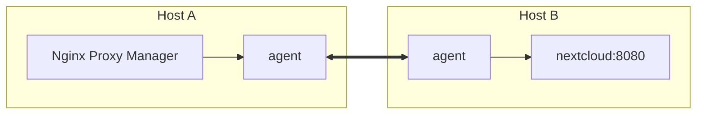

# npm-switchyard

Reach containers on other Docker hosts from Nginx Proxy Manager (or any other container) without
publishing their ports.

> **Status:** concept, no code yet.

## Idea

- Every Docker host runs the same small agent. Agents form authenticated pairs.
- A container is offered to partners only if it shares a network with the agent on its own host.
  Nothing else is configured on that host: no labels, no port lists, no per-service files.
- On the consuming host, a name like `nextcloud.8080.hostb.switchyard` resolves through the agent's DNS
  server to a local address; the agent opens exactly that port on demand (TCP and UDP) and forwards the
  traffic to `nextcloud:8080` on `hostb`.
- In Nginx Proxy Manager the forward host is `<container>.<port>.<partner>.switchyard`; that is the only
  place a service is configured. Optionally the short form `<container>.<partner>.switchyard` takes the
  ports from Nginx Proxy Manager's configuration.

## Platforms

- Linux `amd64` and `arm64`: export and import.
- Windows `amd64` (Windows containers): export only in 1.0.

## Support Me

If npm-switchyard helps you, you can support it: [Buy Me a Coffee](https://ko-fi.com/motwok)

## License

[GNU AGPL v3](LICENSE). See [NOTICE](NOTICE).
