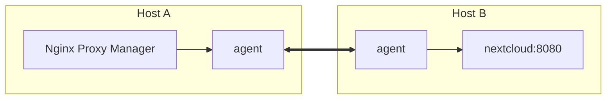

# npm-switchyard

Reach containers on other Docker hosts from Nginx Proxy Manager (or any other container) without
publishing their ports.

## Idea

- Every Docker host runs the same small agent. Agents form authenticated pairs.
- A container is offered to partners only if it shares a network with the agent on its own host.
  Nothing else is configured on that host: no labels, no port lists, no per-service files.
- On the consuming host, a name like `nextcloud.8080.hostb.switchyard` resolves through the agent's DNS
  server to a local address; the agent opens exactly that port on demand (TCP and UDP) and forwards the
  traffic to `nextcloud:8080` on `hostb`.
- In Nginx Proxy Manager the forward host is `<container>.<port>.<partner>.switchyard`; that is the only
  place a service is configured. Optionally the short form `<container>.<partner>.switchyard` takes the
  ports from Nginx Proxy Manager's configuration.



## Platforms

- Linux `amd64` and `arm64`: export and import.
- Windows `amd64` (Windows containers, `1809`, `ltsc2022`, `ltsc2025`): export only in 1.0. The `1809`
  image is built but not tested automatically.
- Docker Engine with API 1.44 or newer.

## Names

| Form | Example | Port |
|---|---|---|
| long | `nextcloud.8080.hostb.switchyard` | the number in the name |
| short | `nextcloud.hostb.switchyard` | every forward port Nginx Proxy Manager uses for this name |
| own host | `cadvisor.8080.local.switchyard` | containers on the agent's own host |

- Names are read from the right: `switchyard`, the partner, then a port if the label is a number
  1..65535, the rest is the container. `www.example.org.8080.hostb.switchyard` is container
  `www.example.org`, port `8080`.
- `<container>` is any name Docker's own DNS would answer for that container in a network it shares
  with the agent: container name, compose service name and other aliases, short ID, hostname, also as
  `<name>.<network>`. Case does not matter.
- Several containers under one name (e.g. a scaled service): each connection goes to one of them.
- Names without `.switchyard` are forwarded unchanged to the DNS servers Docker would use.

## Setup

### 1. A pre-shared key per partner pair

```sh
openssl rand -base64 32
```

Enter the same key on both sides. The key identifies the partner; the partner name is only a local
label and may differ on both sides.

### 2. Exporting host

Attach the agent to the networks whose containers may be reached. Every network of the agent counts,
including the default network compose puts it in; containers in the same stack as the agent are
therefore reachable too.

```yaml
services:
  switchyard:
    image: ghcr.io/motwok/npm-switchyard:latest
    restart: unless-stopped
    environment:
      SWITCHYARD_CONFIG: |
        partners:
          - name: hosta
            psk: ${HOSTA_PSK}
    volumes:
      - /var/run/docker.sock:/var/run/docker.sock:ro
    ports: ["9481:9481"]   # only on the side the partner dials
    networks: [apps]

networks:
  apps:
    external: true
```

### 3. Importing host (with Nginx Proxy Manager)

Create the import network once, with an `ip_range`. Docker hands out only addresses inside
`ip_range`; the rest of the subnet belongs to the agent for the names it answers:

```sh
docker network create --subnet 172.30.0.0/24 --ip-range 172.30.0.128/25 switchyard
```

```yaml
services:
  switchyard:
    image: ghcr.io/motwok/npm-switchyard:latest
    restart: unless-stopped
    cap_add: [NET_ADMIN]
    environment:
      SWITCHYARD_CONFIG: |
        import_network: switchyard
        partners:
          - name: hostb
            address: hostb.example.org:9481
            psk: ${HOSTB_PSK}
    volumes:
      - /var/run/docker.sock:/var/run/docker.sock:ro
      - npm_data:/npm:ro          # only for short names
    networks:
      switchyard:
        ipv4_address: 172.30.0.2  # fixed, outside ip_range

  npm:
    image: jc21/nginx-proxy-manager:latest
    dns: [172.30.0.2]
    volumes:
      - npm_data:/data
      - npm_letsencrypt:/etc/letsencrypt
    networks: [switchyard]
    depends_on:
      switchyard:
        condition: service_healthy
        restart: true

volumes:
  npm_data: {}
  npm_letsencrypt: {}

networks:
  switchyard:
    external: true
```

In Nginx Proxy Manager set the forward host to `nextcloud.8080.hostb.switchyard` and the forward port to
`8080`, or use `nextcloud.hostb.switchyard` with any forward port.

- **Restart:** the agent keeps its name-to-address mapping in memory only. Whenever the agent restarts,
  restart Nginx Proxy Manager too: nginx keeps addresses of streams and custom locations until its next
  reload. `depends_on` with `restart: true` does this for restarts done by compose; after a crash
  restart or a reboot, restart it by hand.
- **Address range:** every short name and every port collision of long names takes one address
  outside `ip_range`. When none is left, new names do not resolve; `switchyard_addresses_free` shows it
  in advance. A restart frees the addresses.
- One side of each pair needs an `address`; the side without one waits for the partner to dial.

### Windows (export only)

```yaml
services:
  switchyard:
    image: ghcr.io/motwok/npm-switchyard:latest
    restart: unless-stopped
    environment:
      SWITCHYARD_CONFIG: |
        partners:
          - name: hosta
            address: hosta.example.org:9481
            psk: ${HOSTA_PSK}
    volumes:
      - type: npipe
        source: \\.\pipe\docker_engine
        target: \\.\pipe\docker_engine
    networks: [apps]
```

## Configuration

The YAML comes from the file given by `-config`, else from the file named in `SWITCHYARD_CONFIG_FILE`,
else from the variable `SWITCHYARD_CONFIG`. It is read once at start. Prefer `SWITCHYARD_CONFIG_FILE`
over `-config`: the health check reads the configuration the same way and does not see the flag.

| Key | Default | Meaning |
|---|---|---|
| `import_network` | none | network the agent answers DNS in; without it the agent only exports |
| `listen` | `9481` | port for partner connections |
| `metrics` | `9480` | port for `/metrics` |
| `npm_data` | `/npm` | Nginx Proxy Manager's `/data`, mounted read-only, for short names |
| `log_level` | `info` | `debug`, `info`, `warn`, `error` |
| `partners[].name` | | local label of the partner, a DNS label |
| `partners[].address` | none | `host:port` to dial; without it the agent waits |
| `partners[].psk` | | base64 key, at least 32 bytes |
| `partners[].spares` | `2` | idle authenticated connections kept ready by the dialing side |

## Monitoring

`GET /metrics` on the metrics port (Prometheus text format):

| Metric | Labels |
|---|---|
| `switchyard_peer_up` | `peer` |
| `switchyard_streams_active` | `peer`, `container`, `service`, `stack` |
| `switchyard_streams_total` | `peer`, `result` (`ok`, `refused`, `error`), `container`, `service`, `stack` |
| `switchyard_bytes_total` | `peer`, `direction` (`in`, `out`), `container`, `service`, `stack` |
| `switchyard_addresses_free` | |

`container`, `service` and `stack` are set by the agent on the target's own host. Publish the metrics
port only to trusted networks.

The image has a health check (`switchyard health`): healthy while the agent runs and, on the importing
side, once its DNS server listens. A disconnected partner does not make it unhealthy.

## Security

- Partner connections use TLS; both sides prove the pre-shared key, bound to the TLS session.
- Only containers that share a network with the exporting agent are reachable, connected by their
  address from the Docker API, never by a name resolved via DNS. The import network is never exported,
  and imported names are never exported again.
- The agent only reads the Docker API. See [SECURITY.md](SECURITY.md).

## Support Me

If npm-switchyard helps you, you can support it: [Buy Me a Coffee](https://ko-fi.com/motwok)

## License

[GNU AGPL v3](LICENSE). See [NOTICE](NOTICE).
