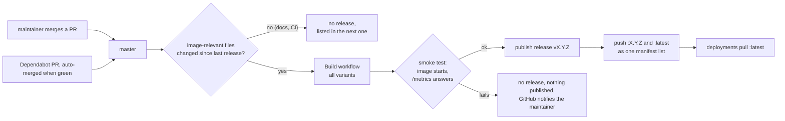

# Releasing npm-switchyard

npm-switchyard is released as a container image with
[Semantic Versioning](https://semver.org) (0.x before 1.0). **Every merge into `master` that changes the
image is a release**. Merges that only touch documentation or CI build nothing new; they are listed in
the next real release. There is no manual release step: merging a pull request is the approval.

## Images

One tag covers all platforms. It is a manifest list; Docker picks the matching variant:

| Platform | Variant |
|---|---|
| Linux `amd64` | static binary, image `FROM scratch` |
| Linux `arm64` | static binary, image `FROM scratch` |
| Windows `amd64` | one image per Windows version (`1809`, `ltsc2022`, `ltsc2025`), based on Nano Server |

Windows containers in process isolation need a base image that matches the host's Windows version,
hence one variant per version. The `1809` variant is built but not smoke-tested: GitHub has no runner
for that Windows version any more.

## Workflows at a glance

| Workflow | File | Trigger | What it does |
|---|---|---|---|
| **Build** | `build.yml` | PR to `master`, push to `master`, manual | Builds all variants and runs the tests. On a push to `master` that changed the image, or when started by hand, it publishes the release `vX.Y.Z` and pushes `:X.Y.Z` and `:latest` as one manifest list (Windows entries with `os.version`). |
| **Release Drafter** | `release-drafter.yml` | PR events, push to `master` | Labels pull requests from their Conventional Commit titles and keeps the release notes of the next version up to date. |
| **Dependabot** | `.github/dependabot.yml` | Dependabot schedule | Opens PRs for dependencies and the GitHub Actions used; they are merged automatically once the build is green. |

## Release flow

## Version numbers

The next version follows from the labels of the merged pull requests:

| Labels | Version step |
|---|---|
| `breaking`, `major` | major |
| `feature`, `enhancement` | minor |
| anything else (`fix`, `docs`, `chore`, `dependencies`, no label) | patch |

Labels are set automatically from Conventional Commit titles (`feat:`, `fix:`, `docs:`, ...).

## Dependency updates are released automatically

**An update of the toolchain or of a dependency triggers a release on its own** (updates of GitHub
Actions only touch CI and do not). Dependabot opens the pull request, it is merged automatically once the
build and the smoke test pass, and the result is a new patch release. If you run `:latest` and redeploy
regularly, you get it without doing anything.

> **Risk:** if a dependency is itself vulnerable or compromised, that is shipped automatically as well,
> before anyone has looked at it.

What limits that risk:

- Dependabot checks **daily**, but waits **3 days** after a new version appears before proposing it
  (cooldown), so a compromised release that is found and pulled quickly never reaches npm-switchyard. Security updates
  for known vulnerabilities are not delayed.
- Build images are pinned and only change through a reviewed-by-CI pull request.
- No release without a green build and smoke test.

If you want to control updates yourself, **pin a version tag** (`:X.Y.Z`) instead of `:latest` and
update deliberately after reading the release notes.

## Rollback

Version tags are never rebuilt. Pin the deployment to the version tag of an earlier release instead of
`:latest`, then switch back to `:latest` once a fixed release is published.

## Deployment

npm-switchyard only publishes images. Pulling `:latest` and redeploying the container is up to the
deployment, for example a scheduled stack redeploy. No credentials are needed: the repository and the
image are public.
